# AWS setup for Person Detection — beginner diagrams

Read steps in order. Each section has one picture of **what you create** and **what connects to what**.

Your app: **frontend** (Streamlit), **backend** (FastAPI), **ml-service** (detection).

---

## Step 0 — Big picture (end goal)

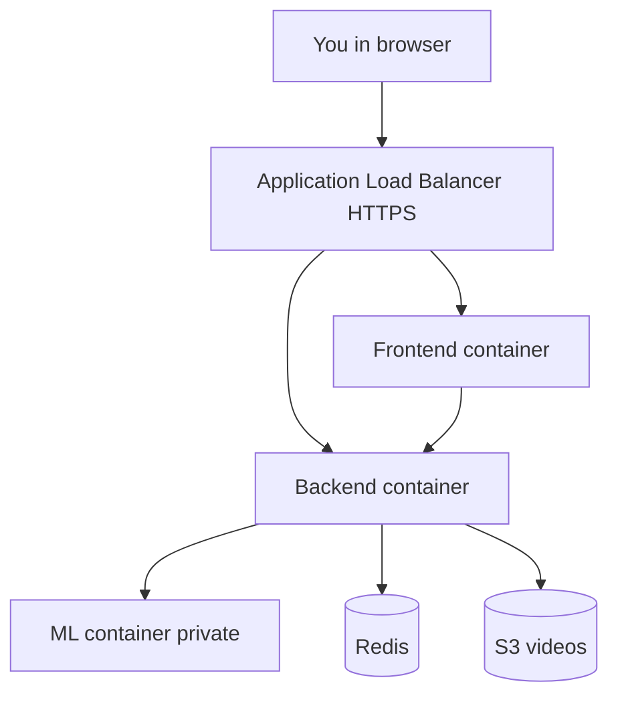

Users never talk to ML directly. Path is Frontend → Backend → ML.

---

## Step 1 — One EC2 server (Tier 1 demo, do this first)

**Goal:** Same as docker compose on your laptop, but on AWS.

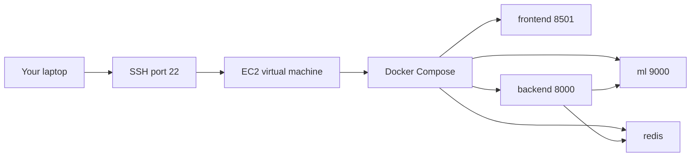

**Console clicks:** EC2 → Launch instance (t3.small) → Security group: SSH 22 from My IP → SSH in → Docker → docker compose up.

**Webcam via tunnel:**

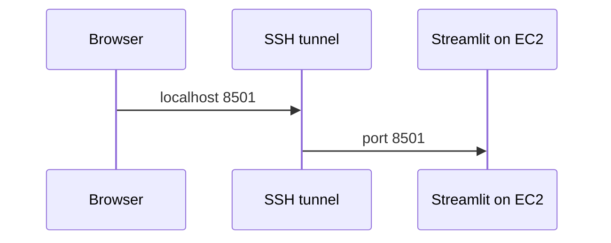

Command: `ssh -L 8501:localhost:8501 user@EC2_IP`

---

## Step 2 — IAM

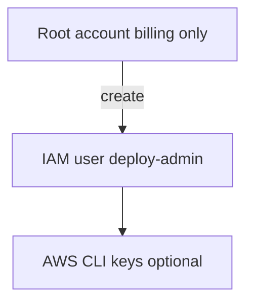

IAM → Users → Create user (no daily root login).

---

## Step 3 — VPC

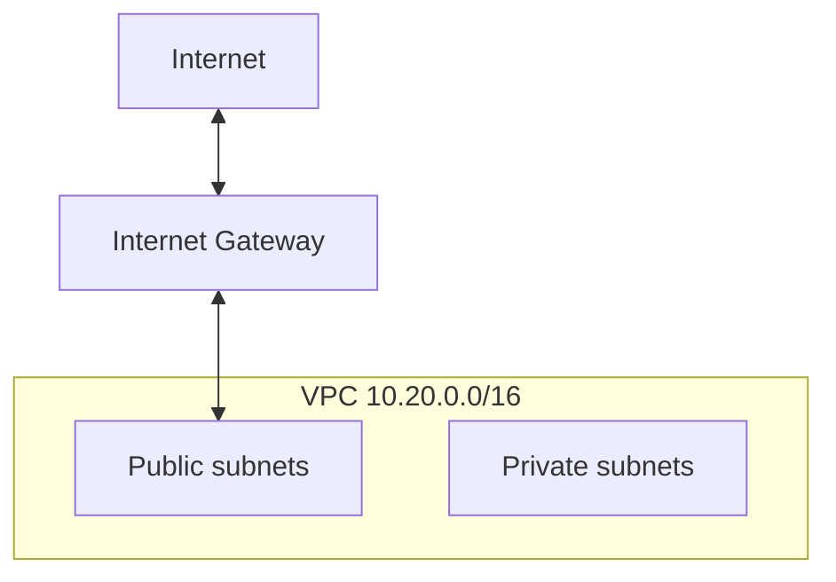

VPC → Create VPC.

---

## Step 4 — Subnets in two zones

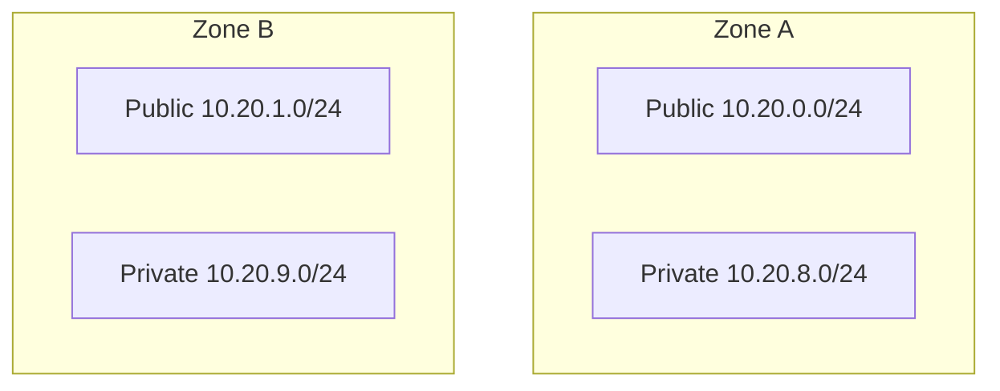

Public subnets: auto-assign public IP ON. Private: OFF.

---

## Step 5 — IGW + NAT

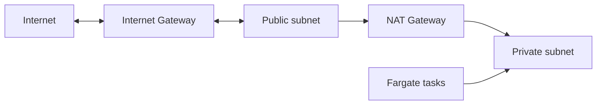

Private tasks pull ECR images through NAT (outbound only).

---

## Step 6 — Security groups

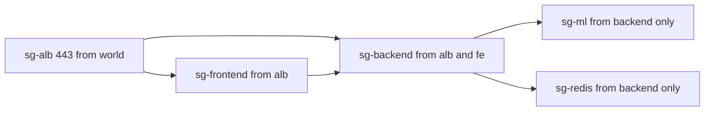

---

## Step 7 — ECR images

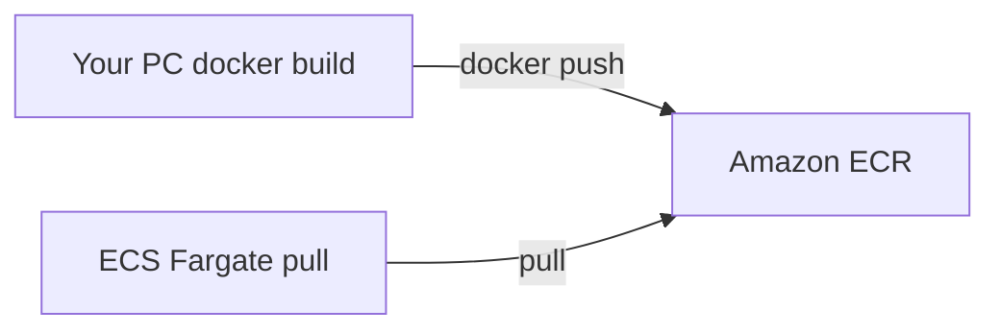

Three repos: frontend, backend, ml-service.

---

## Step 8 — Secrets + S3

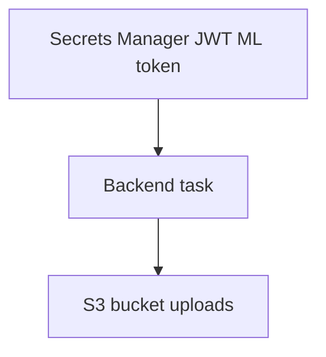

---

## Step 9 — Redis

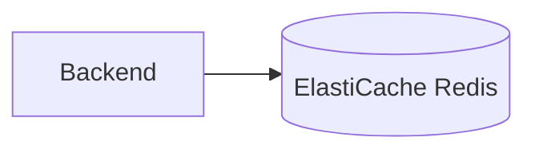

Private subnets + sg-redis.

---

## Step 10 — ACM + ALB (HTTPS)

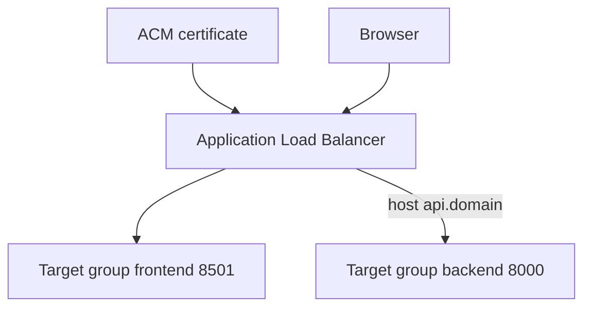

---

## Step 11 — ECS Fargate

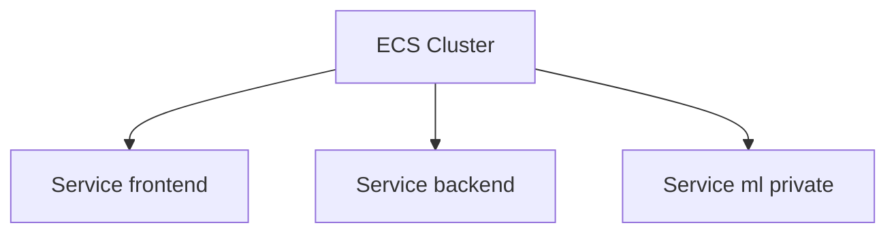

Frontend and backend register to ALB. ML has no public URL.

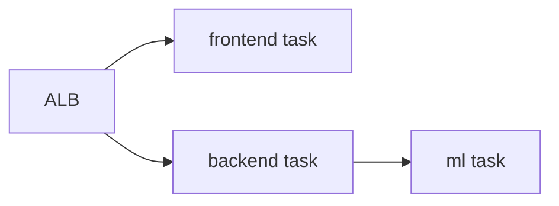

---

## Step 12 — Cloud Map (ML DNS)

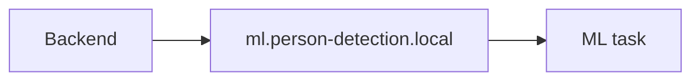

---

## Step 13 — Route 53

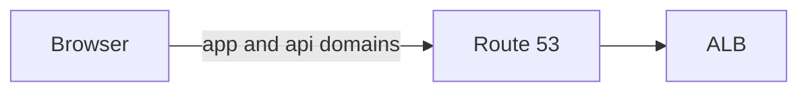

Set frontend BACKEND_URL=https://api.yourdomain.com

---

## Step 14 — WebRTC NLB optional

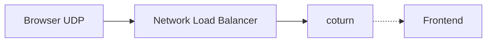

Skip until public domain webcam is required.

---

## Step 15 — Request path check

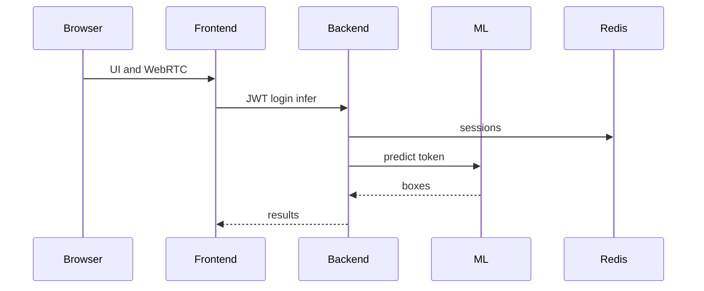

---

## Beginner order (table)

| Order | What | Section |
|------:|------|---------|
| 1 | EC2 + compose | Step 1 |
| 2 | IAM | Step 2 |
| 3 | VPC + subnets | 3–4 |
| 4 | IGW + NAT | 5 |
| 5 | Security groups | 6 |
| 6 | ECR | 7 |
| 7 | Secrets + S3 | 8 |
| 8 | Redis | 9 |
| 9 | ACM + ALB | 10 |
| 10 | ECS + Cloud Map | 11–12 |
| 11 | Route 53 | 13 |
| 12 | NLB WebRTC | 14 |

Checklist text: AWS_MANUAL_SETUP.txt

## Local first (same idea as Step 1)

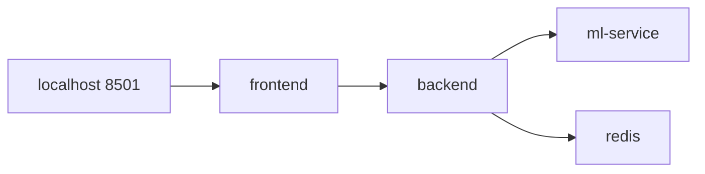
